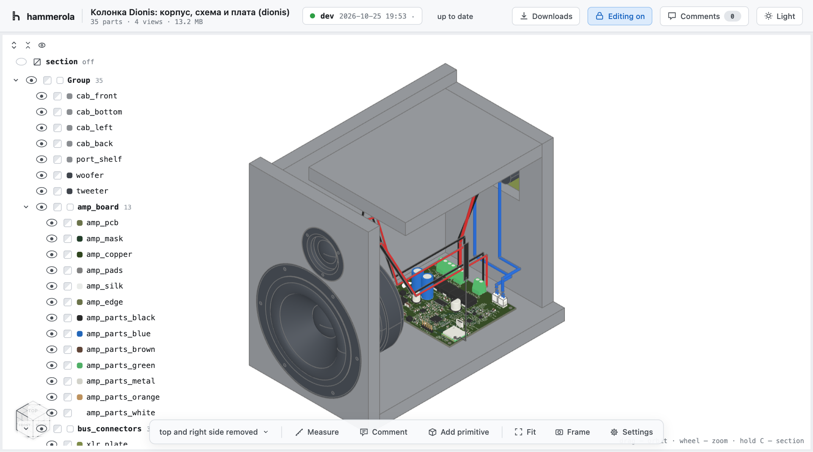
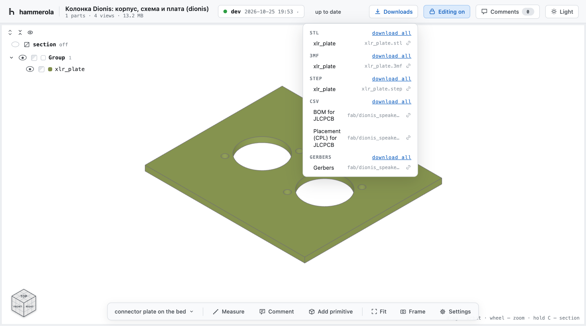
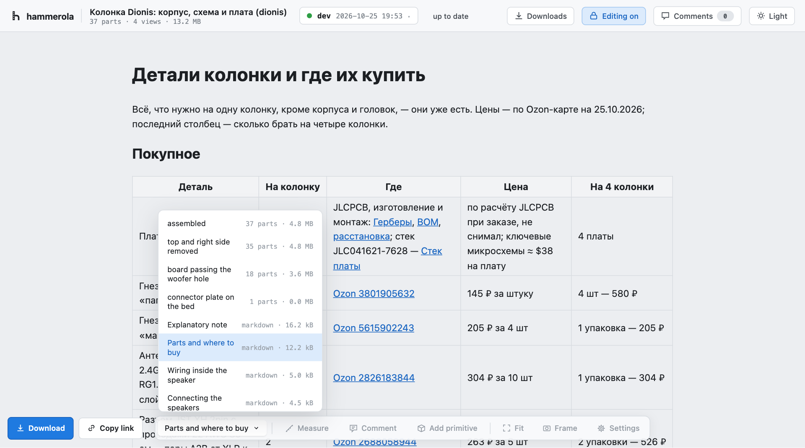
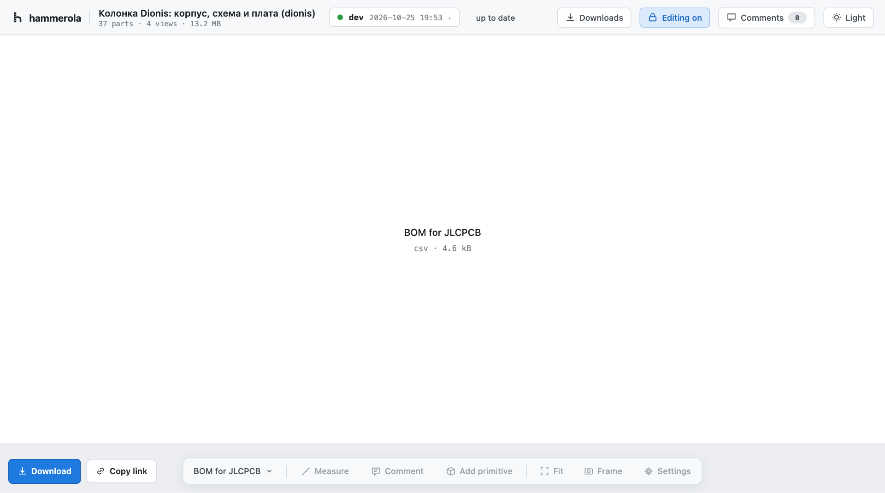
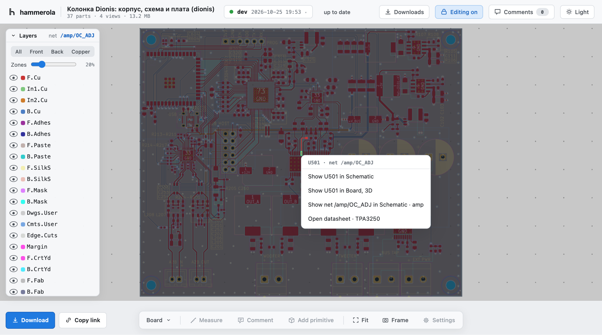
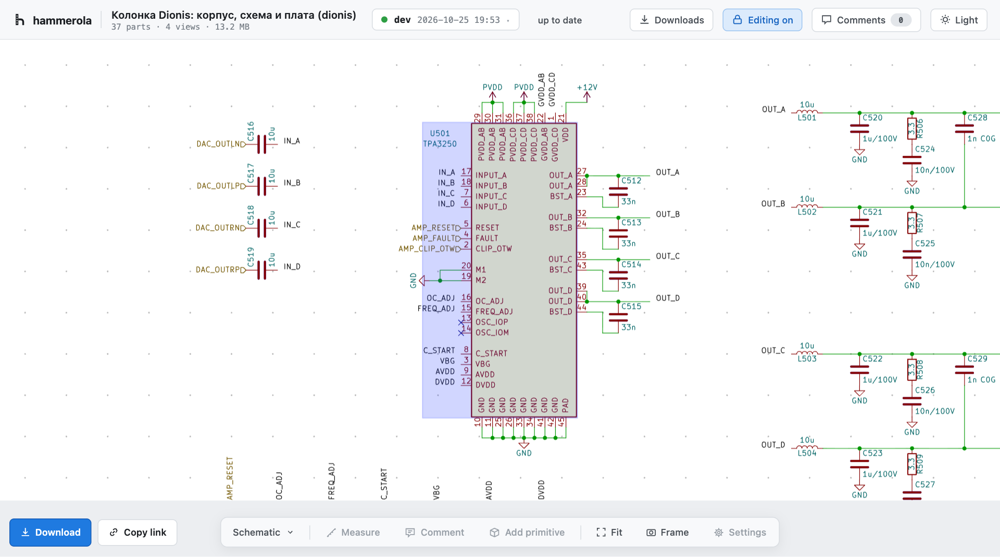
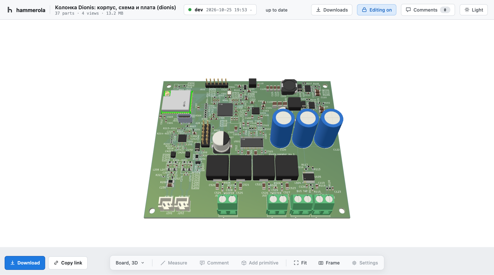
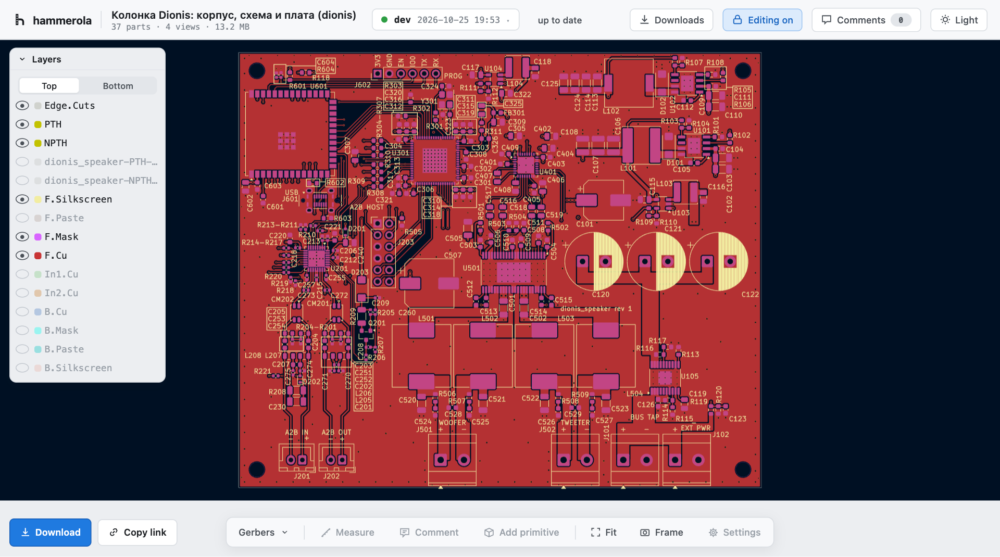

# hammerola

**English** · [Русский](README.ru.md)

A build system and a viewer for parts that an agent models in code. The agent
writes a `model.py` in CadQuery and pushes the source; the hub computes the
geometry and shows the part in a browser. The person turns it, hides what is in
the way, cuts a section through it, measures it, downloads it as STEP/STL/3MF,
clicks a spot on the model and leaves a note there; the agent reads the notes
with `hammerola comments`, fixes the code and pushes the next revision. No CAD
application is needed anywhere: the model is Python, and the kernel that
computes it is in the hub.

The viewer is there because an STL an agent hands back is a poor thing to
review, and words are a poor way to say what to fix. The page gives what a CAD
gives — each part in its own colour, a section through anything, parts you can
drag aside — and a place to point at: the comment is pinned to that point, with
the camera angle it was written from and, when there is one, a photo of the
printed part. A revision's URL never changes and never expires, so a link is
how a part is shown to someone or sent to a workshop. What goes with the part
publishes on the same page — a KiCad schematic and board with the board's
Gerbers, a PDF, a drawing, a Markdown note, or a file of any other kind — and a
project with no model at all publishes those on their own. The name is from
"pianola" — a mechanism that plays itself.

<!-- Screenshots live in docs/images/ rather than in static/. static/ is the
     viewer payload that ships INSIDE the image, and its `hammerola*` names are
     generated and gitignored; README pictures are drawn by the forge straight
     out of the repository and have no business in a container. -->


## How it works

A model is a directory with a `model.py` in it, in a git repository. A version
of it is a commit: `git push` sends it to the project's own repository on the
hub, which **computes the geometry itself** — in a process of its own, with the
CAD kernel that ships in its image — checks the result, exports STEP/STL/3MF
and serves the whole thing at a URL, and only then lets the push in. Nothing is
built on the laptop, and no forge's CI is involved. A directory with no
`model.py` that lists documents in its `project.json` is published the same way,
except that nothing in it is executed: the documents are the whole build.

Four things follow from that, and between them they are what the tool is for.

**A revision is a commit, and a failed build is a refused push.** The author
pushes the whole repository; the project is the directory holding a
`project.json` with its id, so one repository can carry several projects, each
pushed to its own address. Of each push the hub builds the newest commit that
touched the project's directory, publishes it under the commit's sha and only
then lets git move the branch — a build that fails refuses the push, with its
log in the output, so the branch on the hub never stands on a commit without a
build. Builds published before the hub spoke git were imported into that
history as commits of their own, under their old names.

**A published revision never changes and never expires.** Its URL is served as
immutable, and there is no retention anywhere on the hub — nothing ages out and
no build can be taken back on its own — so a link pasted into a chat shows the
same geometry a year later. `dev` is the other kind of slot: one per variant,
rewritten by every `hammerola build`, no history, never listed, and it is where
the working copy goes while a part is still moving — uncommitted, as a draft
the client pushes beside the branch.

**A variant of a project is a branch.** A ceiling and a wall version of one
case are two branches of its repository, each with its own history, `latest`,
draft and documents, and the page switches between them by the project's title,
for a reader with a link as much as for the owner. `main` is the default
variant and keeps the project's addresses; another branch `b` is under
`/project/<pid>/v/<b>/`, labelled by the `"variant"` key of its own
`project.json`, or by its name.

**Geometry that fails the gate is not published.** Every printable has to be a
valid solid with positive volume, export a watertight mesh and come out as one
body. The `assembled` view is required, it has to show every printable unless
it lists one in `absent_ok` with a reason (an assembly jig is printed but is not
part of the product), and no two parts in it may occupy the same space unless the view says why — with one
standing exemption that is not a declaration: a `mock` is scenery, so a pair
holding one is never measured at all, while `hardware` is asked like anything
else. The `print` view is the bed: printables only, each of them the way up the
catalogue holds it, and each on its own patch of it rather than modelled inside
its neighbour. A build that fails any of it is thrown away whole — `latest` and
`dev` do not move — and what comes back is a failure code and the build's own
log.

**The model is public, the files go with a link that includes them, and the
code is not.** A build's page and the geometry it is drawn from are anonymous:
being given the link is what lets you look at the part. Its STEP/STL/3MF leave
only with the one secret or with a link the owner's Share window made with the
files included. Documents are the exception, on purpose: every file a project
lists as one opens to the link alone, whatever its extension, because that link
is how a revision goes to a workshop or a fab as the complete set — so whoever
has it can download a listed KiCad design whole and edit it. The repository a
revision was built from is on the hub too, but behind the secret, and so is the
list of what exists on the hub at all.



## Publishing a model

The client is `hammerola`, and it lives in this repository on purpose: the
client and the hub share one contract — the routes, the ceilings, the job
states — and it used to be split across two repositories
where no test could see both halves, which is exactly how publication came to be
broken without anyone noticing. It imports nothing outside the standard library,
so whatever `python3` a laptop already has is enough.

**It is installed from the hub**, which serves the three things a first run
needs and asks for no token for any of them — they are the software, identical
on every deployment, and the person downloading them does not have a token yet
by definition:

```bash
mkdir -p ~/.local/bin
curl -fsSL <hub>/start/hammerola -o ~/.local/bin/hammerola && chmod +x ~/.local/bin/hammerola
hammerola login <hub>   # once per machine; the password is prompted for, then the
                        # agent instructions go into ~/.claude/skills/hammerola/
```

The instructions are a directory — a short `SKILL.md` an agent keeps in front of
it and reference files it opens when they apply — so the client installs them
rather than a `curl` per file: it writes the whole directory and removes what
the new version no longer ships.

**On a machine where the client is already installed, that `curl` line comes
first.** A client from before the skill was a directory downloads the archive
and tries to read it as text, and its refusal blames the hub for serving
something that is not utf-8; it is that client being older than the hub, and
replacing it (the `curl` above, or `hammerola update`) is the way out.

**That is how it is installed, checkout or no checkout.** There used to be a second
one — `make client`, which symlinked a `bin/hammerola` script into
`~/.local/bin` — and the two collided under the one name they share: `curl -o`
writes THROUGH a symlink, into its target, so the line above quietly landed the
downloaded zipapp on top of the repository's own file. The link stayed a link,
the command went on working, and the only sign was `git status` calling the
client modified. Both the target and the script are gone. Whoever is *working
on* the client runs it out of the checkout instead — and the whole trick is that
`python3` has to be able to import `hammerola`, which is a statement about where
the command is STARTED, not about where the model is:

```bash
cd <this checkout>
python3 -m hammerola --help                          # the same tool, off the working copy
python3 -m hammerola -C <model dir> status           # the model directory is an argument
```

`-C` exists because nothing here is installed by default to run from inside a
model directory: `python3 -m hammerola` started there fails with
`No module named 'hammerola'`, and so does `python3 -m hammerola status` started
in the checkout — the tool resolves, and then finds no `project.json`. The other
way round works too, if the shell is already in the model:

```bash
PYTHONPATH=<this checkout> python3 -m hammerola status
```

No venv and nothing to build either way: the package imports the standard
library and nothing else, which is the same property that lets the hub ship it
as one file.

The downloaded client is a zipapp built out of `hammerola/` — one file, nothing
installed, python 3.9 and up (`src/onboarding.MIN_PYTHON`, which is also what
the skill tells the reader and what a test holds the syntax to: a stock
`/usr/bin/python3` is 3.9 on macOS and on Debian 11, so "newer than that" is a
first onboarding step that fails on the ordinary machine).

`GET /start` is the manifest that names both of those, plus the starter template
`create` fetches below — and one boolean, `empty`, which is the only thing on
this service that says anything about the deployment without the token. It is
deliberately never a count, a name or a date, and it fails closed: a project
directory the hub cannot read answers "not empty", rather than telling somebody
their hub is empty on the strength of an error. It is what the SIGN-IN PAGE of a
hub nobody has pushed to reads: instead of a login form and nothing else, it
draws five lines to hand an agent — what this hub's address is, the command
that installs the client, the one that logs in and installs the skill, read the
skill and follow it, ask the owner for the token. The addresses in it are built
from the browser's own origin and the manifest's paths, so nothing here names a
deployment; the request is made only
when the form is what is on the screen, and every failure of it is silence.
`hammerola create` is the other reader, and it follows `template`. The manifest
also states the DIGEST of the skill this image ships, a sha256 over its files
that `hammerola skill` compares with the same digest of a laptop's copy, and the
VERSION of the client it serves, which is what `build` compares itself against
before it publishes; like the three paths both are constants
of the image and say nothing about the deployment.
`src/onboarding.py` carries the argument for the boolean and for why it is
never a count.

Then, in the part's own directory — named first, because the name is what
`create` reads:

```bash
mkdir t13-ceiling-mount && cd t13-ceiling-mount                    # the directory names the project
hammerola create --title "T13 ceiling mount (t13-ceiling-mount)"   # once: project.json + template
git init -b main && git add -A && git commit -m "start"            # a version is a commit
hammerola connect                                                  # once: the remote hammerola-<pid>
hammerola build                                                    # publish the working copy into `dev`
git commit -am "thicker plate" && git push hammerola-<pid> main    # publish an immutable revision
```

`create` fetches the starter template from the hub and unpacks it beside the
`project.json` it mints — a `model.py` that builds as it stands. It never writes
over anything that is already there, and `--no-template` is the form for a
directory that already has a model, or for a machine with no hub to reach: the
id has always been minted locally and still is.

The title ends with the directory's own slug in brackets, and `create` writes
that slug into `project.json` as a third key, `project` — the latin name the hub
publishes under, on the index card and in the build page header. It is decided
here because here is the only machine where it exists: a push is unpacked on the
hub under a name of the hub's own, so a build that worked the answer out for
itself would name the project after that.

`connect` adds the remote `hammerola-<pid>`, includes from the repository's own
config the file `login` wrote the hub's password into for git, and — for a
project published before git — joins the hub's history into the local `main`
with a merge that changes no file. It prints the push for the branch checked
out: `git push hammerola-<pid> <branch>` publishes a revision of that branch's
variant, and `hammerola build` writes the draft of that branch — of `main` into
`/project/<pid>/dev/`, of any other into `/project/<pid>/v/<branch>/dev/`. A
branch name is letters, digits, `-` and `_`; the hub refuses any other. A
pushed branch stays a variant until `git push --delete hammerola-<pid>
<branch>` removes it with every revision no other variant has; `main` cannot
be removed this way.

Both ways of publishing are a `git push` that waits for the build and prints
what the build printed: `git push hammerola-<pid> main` publishes a revision,
and `hammerola build` commits the working copy through an index of its own —
the author's index and history untouched, what git ignores left out — and
pushes it as the draft. The exit code is the point, because it replaces a
forge's job status: zero means a build was published, and a refused push, a
model that raised, a gate that said no and a hub that could not be reached are
each non-zero with the sentence that says which.

The rest of the commands answer questions about a project that is already there:

```bash
hammerola status                 # latest, dev and the revisions of this branch's variant, and the variants
hammerola log <revision>         # read a build log again
hammerola artifacts <revision>   # its STEP/STL/3MF and its documents
hammerola diff <rev> <rev>       # what moved, in geometry and in source
hammerola comments               # notes left on this project's builds
hammerola proposal               # the edit the viewer's reader proposed, as code
hammerola rename "New title"     # the title, never the id
hammerola skill                  # is the installed agent skill current?
hammerola skill update           # write the hub's copy over it
hammerola update                 # replace THIS TOOL with the hub's copy
```

`skill` and `update` are the odd ones out: they ask about this MACHINE rather
than about a project. `skill` exists because the skill is the only thing here
that goes stale in silence — a client that is behind is refused by its own
`build` and told what to run, while a stale skill goes on confidently teaching a
command that no longer exists. It compares a digest of the installed files
against the one the hub states in `/start`, so any change to any file of the
skill shows, and only ever writes when `update` was typed.

`hammerola update` is the same move one level down: it fetches the client the
hub serves and writes it over the file it is running from — checked first, since
what lands there is what the machine will run next, and written through a rename
so an interrupted update cannot leave a laptop with no tool and no way to fetch
one. It then prints what changed between the two versions, which is what makes
the refusal above worth acting on rather than merely obeying. There is no flag
for where to write: a copy running out of a checkout is told to use git.

`hammerola --help` has the flags, and `hammerola rm` — the one command that
unmakes anything. It removes a project whole, never a single build, and it asks
for the id to be typed first.

## What a model.py looks like

<!-- THE EXAMPLE BELOW STAYS, AND SO DOES model_template/. An earlier note here
     asked for this block to be replaced by a pointer to the template the day
     the template landed (issue #31), on the argument that a contract
     must have ONE source or the second copy drifts in silence. The template
     has landed, and the argument does not apply: NEITHER COPY CAN DRIFT,
     because both are executed. This block is lifted out of README.md and
     built the way a push is built (tests/test_readme_example.py), and
     model_template/ is a working project run through the same build path
     (tests/test_template.py). Two copies that are both built are two copies
     that are both true.

     They are also for different readers. The template is where a project
     STARTS — `hammerola create` fetches it from the hub and unpacks it — and
     it is 12 KB of commented model. This one is short enough to read on the
     repository page without downloading anything, which is what somebody
     deciding whether to use the tool at all is doing.

     So do not delete either, and do not delete tests/test_readme_example.py:
     it is the only thing holding this block to the contract, and because the
     block is now meant to stay, that test FAILS rather than skips if the block
     goes -- a skip nobody reads is not a test. -->

Start a project from the template — `hammerola create` brings it, and it builds
as it stands. What follows is the same contract at a size that can be read here
without downloading anything.

Three functions and one import are the whole contract. `parts()` is the
catalogue — every part of the model under the name it is known by, and where
its geometry lives; `views()` says what the viewer shows, one tab per
view, each of them a list of references into that catalogue; `checks()` is
optional and holds this part to its own numbers. The geometry comes from
`cadquery`, and the shared checks from `checklib` — the third bullet below says
what that one carries.

**And every number in it says where it came from**, which is a ground a push is
refused on and not a convention: a module-level `UPPER_SNAKE` name bound to a
plain float stops the build. `checklib.measured`, `derived` and `estimated` are
how it says which. `estimated` always builds, so this is a rule about SAYING
rather than about measuring — most of a first model is honestly a set of
choices, and the log lists them. `measured` is the one with a cost attached: its
source has to name a file that exists in the project, and — if it names a
heading after a `#` — a heading that is really in that file. How
many of each kind a build declared reaches `metrics.json` exactly, and so do the
notes and the names of the estimates — each list up to the first 256 of them,
after which the file says how many it left out rather than growing without a
ceiling.

```python
"""A flat mounting plate: one printed part, driven by the numbers at the top."""

import cadquery as cq

import checklib

# Every number says where it came from, and the build refuses one that does not:
# `measured(v, "file.md#heading")` for a figure somebody took, `derived(v, why)`
# for one that follows from others, `estimated(v, what_would_settle_it)` for one
# nobody measured. The last always builds, and the log says which numbers it was.
LENGTH = checklib.estimated(60.0, "along X; whatever this bolts to settles it")
WIDTH = checklib.estimated(40.0, "along Y; the same")
THICKNESS = checklib.estimated(4.0, "of the plate; settled by bending one")
HOLE = checklib.derived(5.5, "M5 clearance, ISO 273 medium")
HEAD = checklib.derived(8.5, "M5 socket cap head diameter, ISO 4762")
INSET = checklib.estimated(8.0, "hole centres in from each edge; chosen to "
                                "look right")


def hole_centres():
    x, y = (LENGTH - 2 * INSET) / 2, (WIDTH - 2 * INSET) / 2
    return [(sx * x, sy * y) for sx in (-1, 1) for sy in (-1, 1)]


def plate():
    return (cq.Workplane("XY").box(LENGTH, WIDTH, THICKNESS)
            .faces(">Z").workplane()
            .pushPoints(hole_centres()).hole(HOLE))


def parts():
    """The catalogue, and the one place the geometry lives.

    The key is the part's identity everywhere: the stem it is exported under
    and the name a view points at. The label is DERIVED from it rather than
    equal to it — the exported tree tells repeats of one key apart (`pin`,
    `pin(2)`), and the tree a reader sees puts adjacent repeats back on a
    single counted row (`pin ×4`).
    """
    return {"plate": {"shape": plate(), "kind": "printable"}}


def views():
    """One tab each, and every entry is a REFERENCE into the catalogue.

    `assembled` is the product, `print` is the bed. They hold the same list here
    only because there is one part: a single part is already its own bed layout.
    With two, `print` is where you move them apart with `at`, and the gate
    refuses a `print` view whose parts overlap.
    """
    return [
        {"id": "assembled", "name": "assembled", "parts": ["plate"]},
        {"id": "print", "name": "as printed", "parts": ["plate"]},
    ]


def checks():
    """Optional. Measure the solid rather than restate the numbers above.

    It may take one argument — the directory the build has already exported
    into — for a check that reads the files instead of the geometry.
    """
    part = plate()
    holes = part.faces("%CYLINDER").vals()
    assert len(holes) == 4, f"the plate has {len(holes)} bores, not 4"

    # The shared version of "the screw head has something to bear on". The box
    # is centred, so the seat is the top face at +THICKNESS/2 and the head has
    # the whole plate under it. A check may also report by returning strings.
    problems = []
    for x, y in hole_centres():
        problems += checklib.material_under_head(
            part, (x, y, THICKNESS / 2), HEAD, THICKNESS, name="plate")
    return problems
```

Beside `project.json`, which `hammerola create` writes, that file is the whole
project. Four things about it are worth knowing before writing the second one:

* **A catalogue entry needs `shape` and `kind`; `color` and `note` are
  optional.** `kind` is `printable`, `hardware` or `mock` — what you print, what
  you buy, what is only there so the picture makes sense — and it has no
  default, deliberately: defaulting to `printable` would export a mock of a
  bought bearing and put download buttons under it. An entry that names no
  colour is painted by its kind, so the picture says by itself what goes on the
  bed and what was bought. A VIEW HOLDS NO GEOMETRY, AND HAS ONE DOOR:
  `"plate"` is the part as the catalogue has it, `{"part": "plate", "at": <a
  cq.Location>}` is the same part placed, and `alpha` goes there too — while
  `{"part": "strap", "shape": bent, "deformed": "clamped round the pipe"}` is
  the one way a shape reaches a view at all, for a part that really is a
  different shape in place. The reason is required and is printed into the
  build log, because an unexplained second shape under a part's name is the
  look-alike this whole design refuses; and the plate will not take one, there
  being no "in place" on a bed.
* **`checks()` runs on the hub, and a demonstrably empty one is refused.** The
  build counts the checks in the function's own source, and refuses a body with
  no assert, no raise, nothing filling the list it returns and not so much as a
  call in it — a function that passes for that reason is worse than no
  function. A body it cannot count is not refused: a comprehension, a table of
  checks or a helper handed the problem list gets `count unknown` in the log
  and publishes.
* **`import checklib` is part of the contract**, next to those three names: it
  carries the checks that keep coming up — every pair of parts checked for
  shared volume, a mating face that has to stay flat, material under a screw
  head — so a fix to one of them reaches every project instead of one.
* **Dependencies come from the image and nowhere else.** Nothing is installed on
  a model's say-so, so `model.py` imports what the hub already has: `cadquery`,
  `checklib`, the standard library, and whatever the project ships beside it.

## Documents: boards, drawings and any other file

A part rarely travels alone: there is the board inside it, the cut list, the DXF
for the glass shop, the datasheet of the amplifier. A project publishes those as
DOCUMENTS — files of its tree that `project.json` lists, in the order the page
shows them:

```json
"documents": ["docs/cut-list.md",
              {"file": "hw/main.kicad_sch", "title": "Main schematic"},
              {"file": "hw/main.kicad_pcb", "title": "Main board"},
              {"file": "hw/main.glb", "title": "Main board, 3D"},
              {"file": "fab/main-gerbers.zip", "title": "Gerbers"},
              {"file": "cut/glass.dxf", "title": "Glass, cut list"},
              {"file": "ds/tpa3250.pdf", "title": "TPA3250", "hidden": true}]
```

Nothing is picked up by extension: a file is a document because the list names
it, and it is published under its own path, so a link between two of them works
as it does in the tree. An entry is the path, or an object with the path as
`file`, a `title` the page shows in its place, `"hidden": true` for a file that
is published and opens by its address but has no row in the menu (twenty
datasheets are twenty hidden entries, not twenty rows), and `"download": true`
for a file to be taken rather than drawn. On a model's page the documents follow
the views in the same menu: choosing one shows it over the model, choosing a
view brings the model back, and `?d=<id>` in the address opens one on arrival.
Whatever document is open, Download and Copy link for its file stand at the
bottom left of the page. A project with no `model.py` — `hammerola create
--no-template` starts one — is built out of its documents alone, and its page is
the same menu with no model behind it.



**The extension decides only how a document is shown.** Markdown is drawn, and
a link in it to another listed document opens that document on the page; a PDF,
a picture, HTML and SVG are shown as they are; `.kicad_sch`, `.kicad_pcb`,
`.glb` and `.zip` are the board, below. A file of any other extension — a CSV of
measurements, a supplier's STEP, a firmware image — is a plain file: choosing it
shows its name, extension and size instead of drawing it, and on a model's
build page the Downloads menu offers it under its extension, beside the STL. A
`.dxf` is a plain file with a picture: the hub draws an SVG of it when the push
is checked, publishes it at `<path>.svg`, and the page shows that picture above
the file's name and size.



**A KiCad board is up to three documents with one name.** A schematic, its board
and the board's 3D model whose paths differ only by the extension are one
design. The schematic is listed by its root sheet and brings every sheet it
names, either of the two brings the `.kicad_pro` beside it, and the `.glb` is
made on the laptop with
`kicad-cli pcb export glb`, not on the hub. The views are linked: a part clicked
in one is selected in the others. A right click on a part, a pad or a net in any
view, and on the schematic a left click on a net too — a label, a power symbol,
a sheet pin, a wire — opens one menu: a row for every place it can be shown —
under `PART C507` the part in each view and its datasheet, under `NET +12V` every
place of the net on every sheet and the net on the board.
The menu opens on the row of what was clicked; the arrows ‹ › step from place to
place and a click on a row goes there, switching the view or the sheet, and the menu
stays open.
A part has a datasheet when its `Datasheet` field names a PDF the project lists
(`${KIPRJMOD}/ds/tpa3250.pdf`, hidden above): its row opens the PDF in a window
over the design. The board view has its own panel of layers and lights the whole
net of a clicked track or pad; the 3D view turns like the model does.







**The Gerbers are one zip**, drill files included — what goes to the fab. The
page unzips it in the browser, tells each layer by its `%TF.FileFunction`
attribute rather than by the file's name, and draws copper, mask, silkscreen,
paste, outline and drills with a toggle per layer, from the top or from the
bottom; a model's build page also lists the zip under GERBERS in Downloads. A
`.zip` is read as Gerbers unless its entry says `"download": true`, which is how
a zip of stand logs stays a plain file.



**A wrong list refuses the push, whole.** A path that is not a file, a path
listed twice, a file that would overwrite what the model's build wrote, a DXF
the hub cannot draw, a missing sheet or one outside the project — each is a 422
naming the entry, and nothing is skipped in silence. The complete rules, with
the `kicad-cli` lines for the 3D model and the Gerbers, are written for the
agent that lays a project out: `skill/references/documents.md` and
`skill/references/boards.md`.

## Running a hub

**A hub is one Docker image, and everything it needs is inside it.** That is not
packaging convenience, it is the architecture: the CAD kernel is in the image
(`cadquery` and the native OpenCASCADE binding, with the seven X/GL/expat system
libraries it needs), and nothing is ever installed on a model's say-so — a
`model.py` gets what the image already has and nothing more. The browser bundle
is compiled in a `node:22` stage that never reaches the runtime image, so a
service that is Python does not ship a node toolchain. Alongside them travel the
page templates, the viewer payload, the starter template and the client's own
sources: the one-file zipapp behind `/start/hammerola` is assembled out of those
when the request arrives.

CI builds and publishes it — `.gitea/workflows/image-check-publish.yml`, on every
push:

```
gitea.vvzvlad.xyz/projects/hammerola:latest     # main, what a deploy pulls
gitea.vvzvlad.xyz/projects/hammerola:<sha>      # main, the rollback point
gitea.vvzvlad.xyz/projects/hammerola:<branch>   # anything else
```

`:latest` is pushed LAST of the two, so it moving is the commit of the whole
publication: if `:<sha>` fails to reach the registry the run stops before
`:latest` moves, and what is deployed keeps running the previous image. Only
`main` ever writes `:latest` — a side branch publishes under its own name and
cannot overwrite what production pulls. Do not count on every commit having a
`:<sha>`: a run still queued when the next push lands is cancelled, and with a
build measured in tens of minutes that is ordinary rather than exceptional.

Between the build and the push sits a gate,
`ci/smoke.py`, which starts the image and asks it what a test suite structurally
cannot, because the suite runs against a checkout and never looks at the
artefact: that the entrypoint drops privileges for real, that the
missing-variable guard fires and names the variable, that `.dockerignore` kept
the tests and the `.env` out, that the CAD kernel imports, and that `/start`
really answers. Nothing reaches the registry until it is green, which is also
why `docker login` runs *after* it and never before.

Locally the same image is a plain build with no arguments — but expect it to be
big and slow. The CAD kernel brings VTK with it, hard-pinned by `cadquery-ocp`
itself, and that alone is about 0.6 GB the hub never renders with; it is carried
anyway, because the only way out is substituting a different distribution behind
the declared dependency, and that trade was decided against.

```bash
docker build -t hammerola .
```

**Deploying is `docker-compose.yml` in this repository** — a template with
placeholder values that pulls `gitea.vvzvlad.xyz/projects/hammerola:latest`. Do
not build on the host that serves it. Four things in it are load-bearing rather
than decorative, and each one is spelled out at length in the file itself:

* **One volume at `/app/data`.** Every build, pointer, repository, comment and
  job lives there; nothing ages out, so it grows monotonically and is cleared by
  hand. The volume's real name is `<stack>_<key>`, composed at deploy time —
  getting it wrong does not fail, it silently starts the service from a fresh
  empty one with all the state still sitting in the volume nothing references.
* **One secret, `EDIT_TOKEN`.** It is what publishing, the repositories, the log, the
  comment queue, renaming and removing all check; everything else has a default
  in `src/settings.py`. Without it the service refuses to start and says which
  variable is missing, rather than coming up half-configured.
* **Non-root, by the entrypoint and not by the Dockerfile.** It starts as root,
  fixes ownership of the volume and drops to `app` (uid 1000) with gosu. Nothing
  declares a `USER`, so removing the entrypoint silently gives the service root
  back — which is exactly why the gate checks it on the built image.
* **No `EXPOSE`, and compression at the edge.** The port is published by the
  reverse proxy through compose labels, and so is gzip: a view is JSON in the
  megabytes that compresses about 6.5×, and the application deliberately does
  not compress anything itself. The healthcheck's timings are part of the deploy
  mechanism too — an update that cannot report healthy inside its window is
  rolled back, and a long `interval` with no `start_period` gets a perfectly
  good image rolled back for nothing.

**Working on the hub is the other mode**, and it needs no docker at all.
Everything routine is wrapped in the `Makefile` (`make help` lists all targets):

```bash
make install                # create .venv + install dev/test deps
cp .env.example .env        # fill in the values
make test                   # run tests
make run                    # run the app
```

Python targets create and reuse a local `.venv` automatically — you never need
the system Python. node is needed by the frontend targets only: `make ui`,
which builds the browser bundle, and `make ui-test`, which runs the JS suite.
Both refuse to run without npm. `make test` does not refuse — it runs the
Python suite either way and then says out loud that it skipped the browser
half. What `make run` cannot give you is the CAD kernel unless the machine
happens to have it: a workstation without it serves every page and refuses every
build, which is the one thing the image is there for.

## Where the rest is written down

| File | What it holds |
| --- | --- |
| `AGENTS.md` | The rules themselves, stated in one line each, and where to read the rest. It is deliberately short: it is loaded into every agent's context, so the reasoning lives in the three files below it. Start here before changing anything. |
| `docs/conventions.md` | The same conventions with the reason each one exists — usually the thing that broke silently before it was written down. |
| `docs/repo-map.md` | What every directory and every load-bearing file in this repository is for. |
| `docs/SPEC.md` | The requirements, the facts that were verified the hard way, and the work plan. |
| `ui/README.md` | The browser interface: its layout, its pins, and why it is built twice. |
| `docs/ui-brief.md` | What the interface is FOR: the reading the panels are built around, and the vocabulary they use. |
| `docs/viewer-api.md` | The vendored `three-cad-viewer`: what of it is a public API, and what the viewport reaches into at its own risk. |
